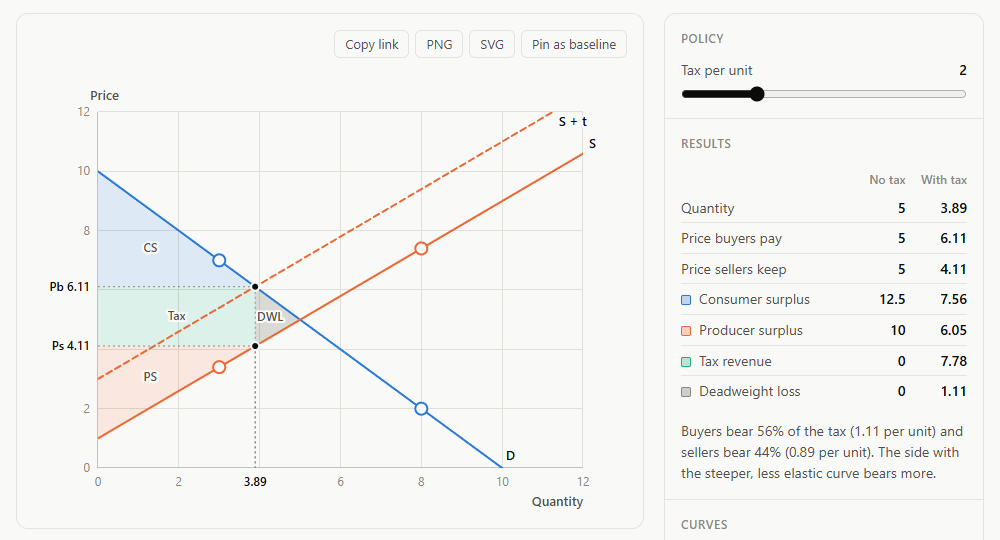
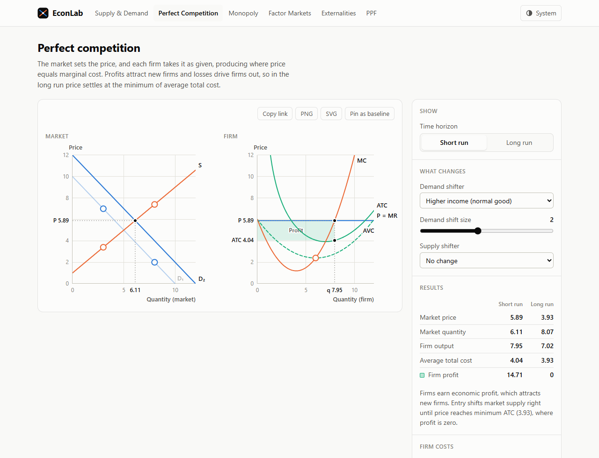
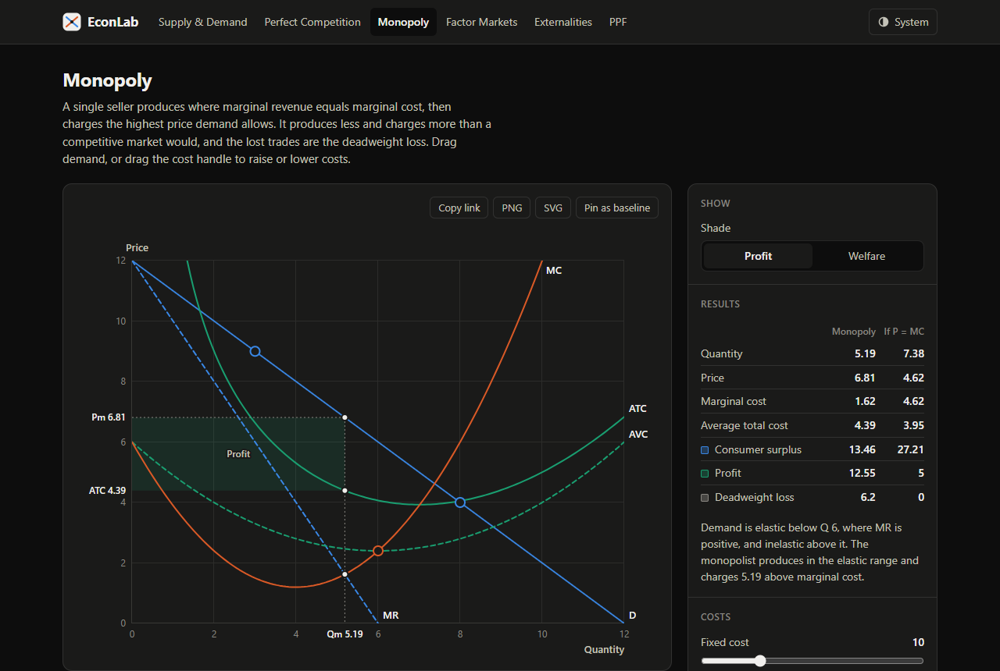
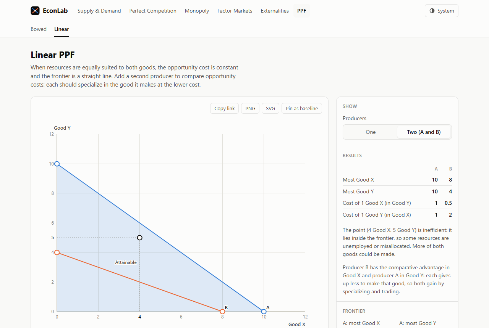
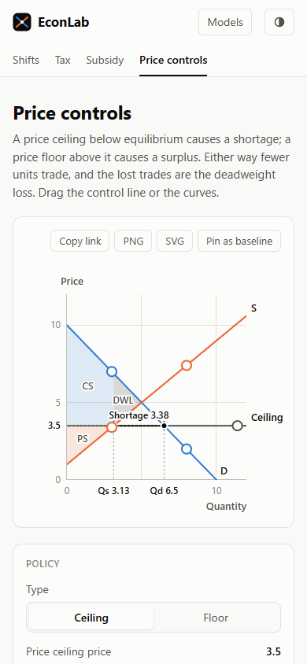

# EconLab

Interactive graphs for introductory microeconomics. Drag a curve and the equilibrium,
surplus, deadweight loss and every result update as you move it.



EconLab covers the graphs of an AP or first-year microeconomics course: supply and
demand, taxes, subsidies, price controls, perfect competition, monopoly, labor
markets, externalities and the production possibilities frontier. It runs entirely
in the browser, with no backend.

## Features

- **Twelve models in six topics.**
  - **Supply and demand:** curve shifts, per-unit taxes, subsidies, price ceilings and floors.
  - **Firms:** perfect competition (short run and long run) and monopoly with cubic costs.
  - **Factor markets:** a competitive labor market and monopsony.
  - **Externalities:** negative and positive, with the corrective tax or subsidy.
  - **PPF:** bowed and linear frontiers, with comparative advantage between two producers.
- **Direct manipulation.** Drag curves to shift them, drag their second handle to
  change the slope, or drag a policy line. Each handle also works from the keyboard.
- **Exact results.** Equilibria, consumer and producer surplus, tax revenue,
  deadweight loss and profit are found analytically, not by sampling, and the
  matching areas are shaded on the graph.
- **Plain-language explanations.** Each result is explained in words, for example who
  bears a tax and why.
- **Scenario comparison.** Pin the current graph as a baseline, change something, and
  compare the two side by side.
- **Sharing and export.** Every page keeps its state in the URL, so a copied link
  reopens the same graph. Graphs export as PNG or SVG.
- **Works everywhere.** Responsive down to phone width, light and dark themes, and
  accessible labels, tables and keyboard controls.

| Perfect competition                                                  | Monopoly (dark theme)                                  |
| -------------------------------------------------------------------- | ------------------------------------------------------ |
|  |  |
| **Comparative advantage**                                            | **Phone**                                              |
|                                      |            |

## How it's built

React 19, TypeScript, Vite and React Router. The graphs are hand-written SVG; there
is no charting library. The code is in three layers, each depending only on the
ones before it:

1. **Economics engine** ([`src/econ`](src/econ)). Pure TypeScript functions with no UI
   code. Curves are lines and cost curves are polynomials, so intersections and areas
   are computed exactly. Every solver returns a `Result` that is either a value or a
   readable error, such as a market that clears at a negative price, so pages never
   draw an impossible graph.
2. **Graph engine** ([`src/graph`](src/graph)). Reusable SVG pieces: axes, curves,
   shaded areas, point markers, drag handles and a hover crosshair. Labels are kept
   from overlapping each other, and values on the axes are spread apart. Export
   copies the rendered SVG with its styles inlined.
3. **Pages** ([`src/pages`](src/pages)). Each model combines the two: it reads its
   state from the URL, solves the model and draws the result. The shared layout,
   controls, results table and comparison live in [`src/ui`](src/ui).

The engine and the pages are covered by unit tests with Vitest. The expected values
were worked out by hand, not copied from the engine's output. GitHub Actions runs
lint, formatting, type checking, tests and a production build on every pull request.

## Running locally

Requires Node.js 22.12 or later.

```sh
npm install
npm run dev          # start the dev server
npm test             # run unit tests
npm run lint         # ESLint
npm run typecheck    # TypeScript
npm run build        # production build to dist/
```

**Windows note:** if every test suite fails with "Vitest failed to find the current
suite", the terminal's working directory probably has a lowercase drive letter
(`c:\...`), which makes Vitest load itself twice. Run `cd C:\path\to\project` with
an uppercase drive letter and try again.

## History

EconLab began in 2024 as **Smithenes**, an AP Microeconomics graphing calculator. You
filled in a form, a Flask API drew the graph with matplotlib, and the page showed it
as an image. The rewrite moved the economics into the browser, so graphs update
while you drag them. The original API is archived with its full commit history in
[`legacy/backend`](legacy/backend).
